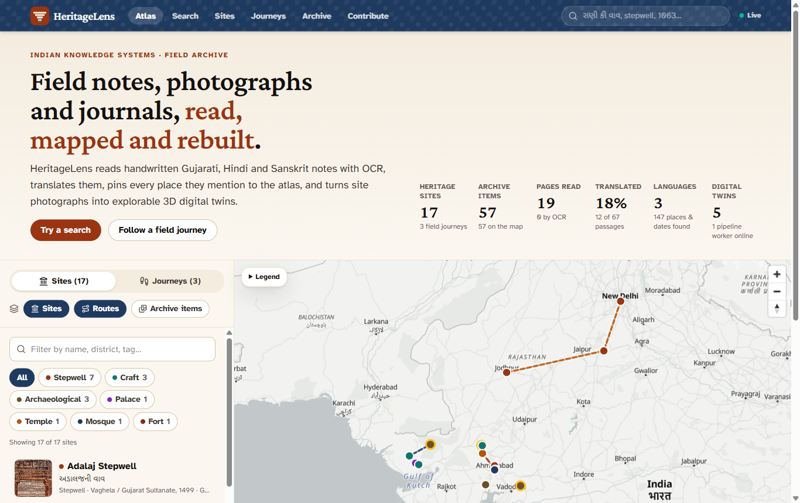
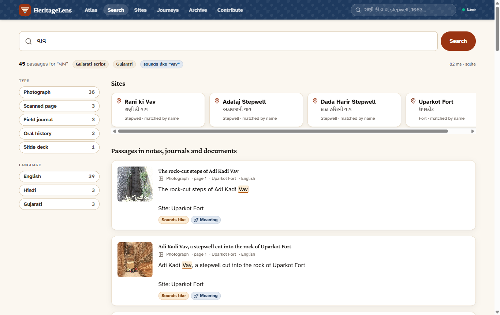
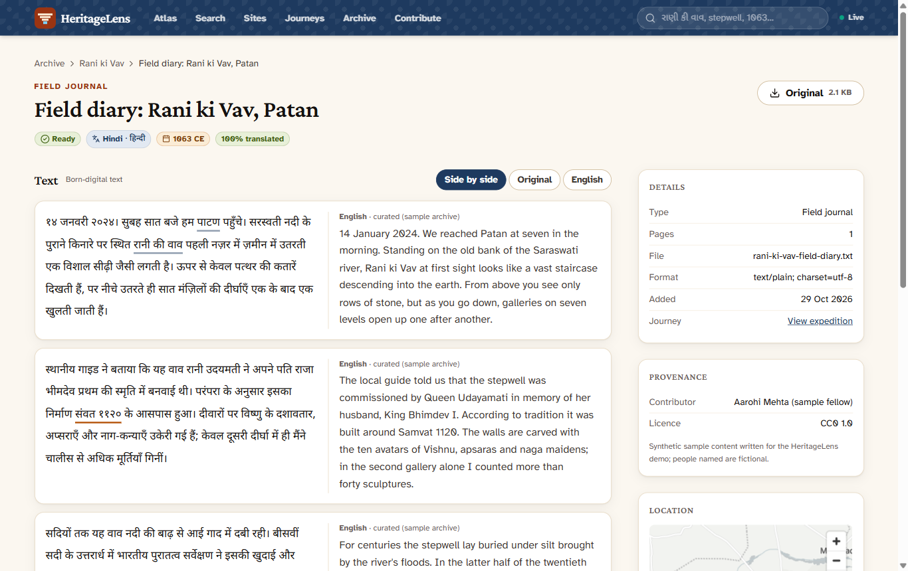
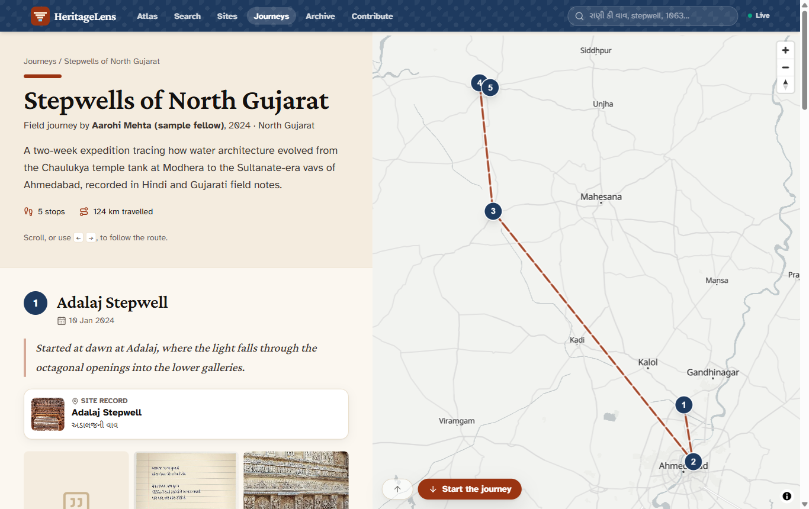
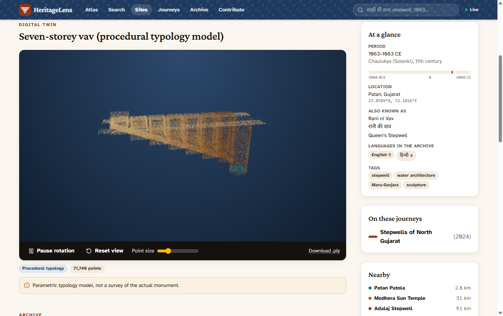
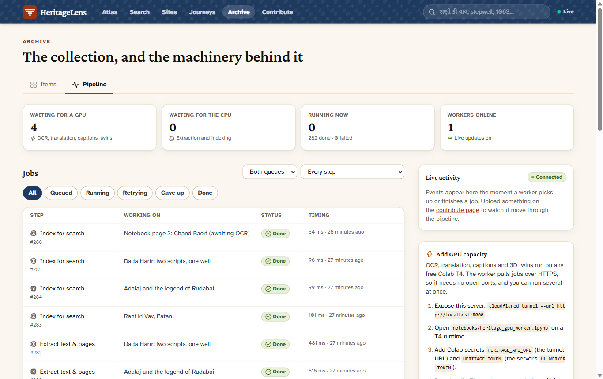
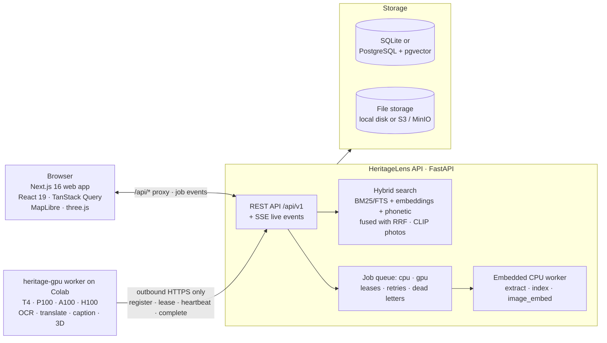
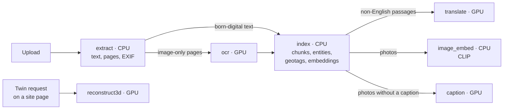

# HeritageLens

**Turning unstructured cultural and architectural heritage archives into a searchable, mappable, immersive atlas.**

[](https://github.com/kushpatel2601/HeritageLens/actions/workflows/ci.yml)
[](https://colab.research.google.com/github/kushpatel2601/HeritageLens/blob/main/notebooks/heritage_gpu_worker.ipynb)

Built for **HackCult ’26, IIT Gandhinagar**, Track 2, **HC26-CULT01**: *Digital Revitalisation of Unstructured
Cultural & Architectural Heritage Archives*.

**Live demo:** <https://heritagelens-hc26.vercel.app> · API and docs: <https://heritagelens-hc26.onrender.com/docs>

**Demo video (3 min):** <https://heritagelens-hc26.vercel.app/demo/heritagelens-demo.mp4> ([watch on the site](https://heritagelens-hc26.vercel.app/#demo), [subtitles](demo/heritagelens-demo.srt); file in the repo: [frontend/public/demo/heritagelens-demo.mp4](frontend/public/demo/heritagelens-demo.mp4))

**Pitch deck (10 slides, tagged PDF):** <https://heritagelens-hc26.vercel.app/heritagelens-pitch-deck.pdf> (file in the repo: [frontend/public/heritagelens-pitch-deck.pdf](frontend/public/heritagelens-pitch-deck.pdf))
(free tiers; if the API has been idle, the first request can take about a minute while it wakes).



---

## The problem

Decades of fieldwork on India’s built heritage sit in folders nobody can search: scanned Gujarati and Hindi
notebooks, PDFs, slide decks, travel journals, oral histories and thousands of untagged photographs. The text is
in several scripts, much of it is only an image, and nothing links a note to the place it describes.

## What HeritageLens does

It covers all three pathways from the problem statement in one system.

| Pathway | What you get |
|---|---|
| **1. Regional text archives** | Upload scans, PDFs, DOCX, PPTX, TXT or photos. Pages are OCR’d (Gujarati, Hindi, Marathi, Sanskrit, English), translated to English, split into passages, tagged with places, sites and dates, and indexed. **Cross-script search** means `વાવ`, `बावड़ी`, `vav` and `stepwell` all find the same stepwells. |
| **2. Interactive atlas** | A map of heritage sites, Explorer-Fellowship expedition routes and geotagged photographs. Geotags come from EXIF, manual entry, the linked site, or a place named in the text. Journeys open in a step-by-step **story mode**. |
| **3. 3D digital twins** | Any site’s archive photos can be turned into a 3D model on a free Colab GPU: a Depth Anything V2 relief from a single photo, or a Gaussian splat (COLMAP + gsplat) from eight or more. Twins open in the browser. |

**Screenshots**

| Cross-script search | Document reader (original ↔ English) |
|---|---|
|  |  |
| **Journey story mode** | **3D digital twin** |
|  |  |



---

## How it maps to the judging criteria

| Criterion | Where to look |
|---|---|
| **Technical Execution & Code Quality (40%)** | Typed end to end: Pydantic schemas → OpenAPI → generated TypeScript client, so a backend change that breaks the UI fails `tsc`. **326 automated tests** (backend 143 at 85% line coverage, GPU worker 119, frontend 64); ruff, mypy, ESLint and `tsc` are clean; CI runs all of it plus OpenAPI/client drift checks. Uploads are checked by magic bytes, size and page limits, and de-duplicated by hash. |
| **System Architecture & Scalability (30%)** | Stateless FastAPI service; a durable job queue with separate **CPU and GPU queues**, leases, heartbeats, retries with backoff and dead-lettering (`SELECT … FOR UPDATE SKIP LOCKED` on PostgreSQL). GPU workers **pull** work over outbound HTTPS, so any number of Colab sessions can join without open ports. SQLite for a laptop, PostgreSQL + pgvector (HNSW) for production; local disk or S3/MinIO for files. The live demo runs the same code on free tiers: the API in 512 MB on Render using an ONNX export of the multilingual embedder (identical vectors, a third of the memory), the web app on Vercel’s CDN. |
| **UI/UX (20%)** | One coherent parchment-and-ink design system; map-first atlas; side-by-side reader; live pipeline updates over Server-Sent Events; drag-and-drop contribution with per-file progress. Checked at desktop and phone widths (360 px) with no sideways scrolling; keyboard focus, labels and reduced-motion support throughout. |
| **Innovation & Problem Fit (10%)** | Phonetic cross-script matching for Indic place names, hybrid search fused with Reciprocal Rank Fusion, CLIP text-to-photo search for untagged photographs, a translation memory so nothing is translated twice, and free-GPU 3D reconstruction from photos the archive already holds. |

---

## Architecture



### Processing pipeline

Every upload becomes a chain of small, idempotent jobs. Each job is de-duplicated, so re-processing an asset never
does the same work twice.



* **CPU jobs** run inside the API process (or in extra `python -m app.cli worker` processes).
* **GPU jobs** wait in the GPU queue until a `heritage-gpu` worker leases them. If Tesseract is installed on the
  server, OCR can also fall back to the CPU queue.
* A lost lease (for example, a Colab disconnect) re-queues the job automatically; malformed results are
  dead-lettered instead of retried forever. Failed jobs can be retried from the pipeline dashboard.

### Search

A query runs three retrievers and fuses their rankings with **Reciprocal Rank Fusion** (k = 60):

1. **Lexical:** BM25 over original text, English translations and a phonetic key (PostgreSQL full-text search when
   running on PostgreSQL).
2. **Semantic:** multilingual sentence embeddings (`paraphrase-multilingual-MiniLM-L12-v2`, ONNX on CPU).
3. **Phonetic cross-script:** Gujarati, Devanagari and Latin are transliterated to one key, so `વાવ` ≈ `वाव` ≈ `vav`.

Results come back as passages with highlighted snippets, English glosses, kind and language facets, and matching
sites. They can be filtered by kind, language, site, journey, category, era or map area. A separate CLIP index
finds photographs by description, even when they have no caption.

---

## Run it locally

No Docker is needed. You need **Python 3.11+** and **Node.js 20.9+** (CI uses Python 3.12 and Node 24).

### 1. API (port 8000)

```bash
cd backend
python -m venv .venv
# Windows: .venv\Scripts\activate    macOS/Linux: source .venv/bin/activate
pip install -e ".[ml,dev]"          # `ml` adds real multilingual embeddings and CLIP photo search
python -m app.cli migrate           # create the SQLite database in backend/var/
python -m app.cli seed              # load the sample archive (17 sites, 3 journeys, 59 assets)
python -m app.cli serve             # http://127.0.0.1:8000 · API docs at /docs
```

Settings are environment variables prefixed `HL_`; see [`backend/.env.example`](backend/.env.example). Without the
`ml` extra the API still runs, using a deterministic hashing embedder and no photo search.

### 2. Web app (port 3000)

```bash
cd frontend
npm install
npm run dev                         # http://localhost:3000
```

The web app proxies `/api/*` to `API_ORIGIN` (default `http://127.0.0.1:8000`). If the API runs on another port,
set it first, for example `API_ORIGIN=http://127.0.0.1:8010 npm run dev` (PowerShell:
`$env:API_ORIGIN="http://127.0.0.1:8010"; npm run dev`). See [`frontend/.env.example`](frontend/.env.example).

Try searching for `વાવ`, `बावड़ी`, `vav` or `stepwell`, open a site’s 3D twin, or drop files on **Contribute**.

### 3. GPU worker on Colab

GPU jobs (OCR, translation, captions, 3D twins) wait in the queue until a GPU worker connects.

1. Point the worker at an API it can reach: the live demo
   (`https://heritagelens-hc26.onrender.com`, token from the Render service’s **Environment** tab), or your local
   API through a tunnel, for example `cloudflared tunnel --url http://localhost:8000`.
2. Open [`notebooks/heritage_gpu_worker.ipynb`](notebooks/heritage_gpu_worker.ipynb) in Colab (badge above),
   choose a GPU runtime, set `HERITAGE_API_URL` and `HERITAGE_TOKEN` (the server’s `HL_WORKER_TOKEN`), and run
   all cells.
3. Watch the jobs complete live on **Archive → Pipeline**.

The worker can also run on any machine with `pip install "./ml[models]"` and `python -m heritage_gpu run`. Engines,
flags and the lease protocol are documented in [`ml/README.md`](ml/README.md).

---

## Deploy it free (Render + Vercel)

The live demo costs nothing and needs no card. Render redeploys the API on every push to `main` that touches it; the
web app is deployed from the CLI (or connect the repository in Vercel with Root Directory `frontend`).

**API on Render** (free web service: 512 MB RAM, sleeps after 15 idle minutes, ephemeral disk)

1. Click **New → Blueprint** in Render and pick this repository, or open
   `https://render.com/deploy?repo=https://github.com/kushpatel2601/HeritageLens`. [`render.yaml`](render.yaml)
   builds [`deploy/render/Dockerfile`](deploy/render/Dockerfile) and generates `HL_WORKER_TOKEN`.
2. The image downloads the archive snapshot and the lean ONNX embedder from the `deploy-assets` release, checked
   against the SHA-256 hashes in [`assets.lock.json`](deploy/render/assets.lock.json). To publish a new snapshot,
   run [`build_assets.py`](deploy/render/build_assets.py).
3. Set the repository variable `API_URL` to the service URL. The [keep-alive workflow](.github/workflows/keepalive.yml)
   then pings `/api/v1/health` every 5 minutes so the demo stays awake.

**Web app on Vercel** (Hobby plan)

```bash
cd frontend
npx vercel link
npx vercel env add API_ORIGIN production                  # https://<your-service>.onrender.com
npx vercel env add NEXT_PUBLIC_WORKER_API_URL production  # same URL, shown in the pipeline's "Add GPU capacity" panel
npx vercel deploy --prod
```

[`vercel.json`](frontend/vercel.json) selects the Next.js preset and the Singapore region, next to the API. The
browser only talks to Vercel; `/api/*` is rewritten to Render, and immutable files (originals, 3D twins) are cached
at Vercel’s edge.

**Check a deployment:** `python deploy/render/smoke_test.py --api https://<api> --web https://<web>` runs 31
read-only checks (health, catalogue, cross-script search, SSE, worker auth, every page and the proxy).

**Free-tier trade-offs:** CLIP photo search is off (it alone needs about 350 MB). Uploads work but disappear when
the service restarts or redeploys. Without a GPU worker, OCR falls back to Tesseract on a shared CPU, which is slow
and weaker on handwriting; connect the Colab worker for the real models.

---

## Tests and quality checks

CI ([`.github/workflows/ci.yml`](.github/workflows/ci.yml)) runs on pushes to `main` and on pull requests. Nothing
needs a GPU or model downloads.

| Part | Command | Checks |
|---|---|---|
| Backend | `cd backend && pytest --cov` | 143 tests, 85% coverage; plus `ruff check`, `ruff format --check`, `mypy app` and an OpenAPI drift check |
| GPU worker | `cd ml && pytest` | 119 tests, including a contract test that drives the real API with the real worker and fake engines; plus ruff and mypy |
| Frontend | `cd frontend && npm test` | 64 Vitest tests; plus `npm run lint`, `npm run typecheck`, `npm run build` and a generated-client drift check |

---

## Project structure

```text
backend/               FastAPI service (package: heritagelens-api)
  app/api/             routes: assets, search, sites, journeys, twins, jobs, workers, ops (health, stats, SSE)
  app/core/            settings, logging, errors, security
  app/db/              SQLAlchemy models (SQLite and PostgreSQL + pgvector)
  app/services/        ingest, extraction and indexing pipeline, job queue, hybrid search, storage, geo, twins
  app/seed/            sample archive loader and data
  migrations/          Alembic migrations (PostgreSQL)
  tests/               pytest suite
ml/                    heritage-gpu: pull-based GPU worker (OCR, translation, captions, 3D reconstruction)
notebooks/             Colab notebook that runs the GPU worker
frontend/              Next.js 16 app (App Router, Tailwind CSS v4, TanStack Query, MapLibre, three.js)
  src/app/             pages: atlas, sites, journeys, search, assets, contribute, archive, pipeline
  src/components/      UI by feature (atlas, search, asset reader, viewer, contribute, archive, ...)
  src/lib/api/         OpenAPI document, generated types and typed client
deploy/render/         free Render deployment: Dockerfile, pinned asset snapshot, live smoke test
docs/screenshots/      images used in this README
```

---

## Credits and licences

HeritageLens is released under the MIT licence. It builds on these open models and data:

| Component | Used for | Licence |
|---|---|---|
| [Tesseract 5](https://github.com/tesseract-ocr/tesseract) + [`tessdata_best`](https://github.com/tesseract-ocr/tessdata_best) | OCR | Apache-2.0 |
| [Qwen2.5-VL-3B-Instruct](https://huggingface.co/Qwen/Qwen2.5-VL-3B-Instruct) (optional) | OCR of faded or handwritten pages | Qwen Research Licence (**non-commercial**) |
| [IndicTrans2 Indic→En 200M](https://huggingface.co/ai4bharat/indictrans2-indic-en-dist-200M) (AI4Bharat) | Translation | MIT |
| [NLLB-200 distilled 600M](https://huggingface.co/facebook/nllb-200-distilled-600M) (fallback) | Translation | CC-BY-NC-4.0 (**non-commercial**) |
| [BLIP large](https://huggingface.co/Salesforce/blip-image-captioning-large) | Photo captions | BSD-3-Clause |
| [Depth Anything V2 Base](https://huggingface.co/depth-anything/Depth-Anything-V2-Base-hf) | Single-photo 3D relief | CC-BY-NC-4.0 (**non-commercial**) |
| [COLMAP](https://colmap.github.io/) and [gsplat](https://github.com/nerfstudio-project/gsplat) | Multi-photo Gaussian splats | BSD-3-Clause / Apache-2.0 |
| [paraphrase-multilingual-MiniLM-L12-v2](https://huggingface.co/sentence-transformers/paraphrase-multilingual-MiniLM-L12-v2) via [fastembed](https://github.com/qdrant/fastembed) | Semantic search | Apache-2.0 |
| [CLIP ViT-B/32](https://huggingface.co/Qdrant/clip-ViT-B-32-vision) via fastembed | Text-to-photo search | MIT |
| [MapLibre GL JS](https://maplibre.org/), [three.js](https://threejs.org/) | Map and 3D viewer | BSD-3-Clause / MIT |
| [OpenFreeMap](https://openfreemap.org/) tiles, © [OpenStreetMap](https://www.openstreetmap.org/copyright) contributors | Basemap | ODbL |

The models marked **non-commercial** are fine for research and demo use. A commercial deployment should use the
permissive options instead: Tesseract for OCR, IndicTrans2 for translation, and COLMAP + gsplat (or the Apache-2.0
Depth Anything V2 Small) for 3D.

**Sample data.** Site photographs come from [Wikimedia Commons](https://commons.wikimedia.org/), mostly under
CC BY-SA (a few CC BY, CC0 or public domain); each photo’s author, licence and source link are shown on its page. The field journals, scanned notes,
slide deck, oral histories and expedition fellows in the seed archive are **synthetic**: written for this demo and
released under CC0. Site facts (names, locations, eras) are public knowledge.
