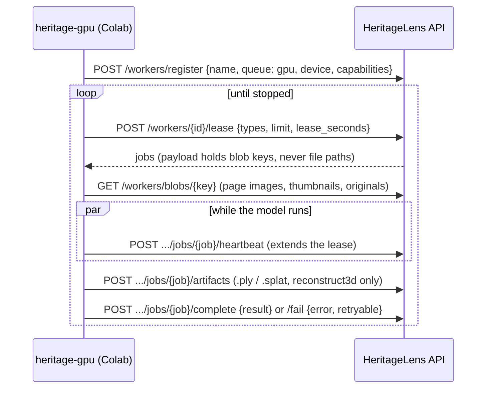

# heritage-gpu: the HeritageLens GPU worker

`heritage-gpu` turns any GPU, typically a free Google Colab T4, P100, A100 or H100, into a processing node for a
HeritageLens server. It **pulls** work over outbound HTTPS, so the GPU host needs no inbound port, public IP or
shared filesystem. One `pip install` and two environment variables are enough to add capacity, and any number of
workers can run at once.

**Quick start on Colab:** open [`notebooks/heritage_gpu_worker.ipynb`](../notebooks/heritage_gpu_worker.ipynb)
and run the cells top to bottom.

## What it runs

| Job type | Default engine | Alternatives | Result stored by the server |
|---|---|---|---|
| `ocr` | Tesseract 5 LSTM (`tessdata_best` guj/hin/mar/san/eng). Pages are upscaled and contrast-stretched in grayscale; with no language hint, Tesseract's OSD picks the script model; word confidences are kept | `--ocr-engine vlm`: Qwen2.5-VL-3B (about 8 GB in fp16) for faded or handwritten pages | Page text, engine and confidence. Pages become searchable |
| `translate` | `auto`: IndicTrans2 (AI4Bharat, 200M distilled); falls back to NLLB-200 (600M distilled) if IndicTrans2 cannot load | `--translator indictrans2` or `nllb` | English gloss per chunk, kept in a translation memory so it is never paid for twice |
| `caption` | BLIP-large | – | Caption, shown and indexed for photos that had none |
| `reconstruct3d` | `depth-relief`: Depth Anything V2 lifts one archive photo into a coloured point-cloud relief | `gaussian-splat` (8+ overlapping photos): COLMAP SfM, then gsplat training, exported as `.splat`. Falls back to `sfm-points`, then to a relief | `.ply` or `.splat` artifact plus a twin record on the site |

Model weights load lazily on the first job of each type, or with `--preload`. Precision is bf16 on Ampere and
newer GPUs, fp16 on T4 and P100, and fp32 on CPU.

## Install

```bash
pip install "./ml[models]"            # torch, transformers, pytesseract (Colab already ships most of these)
pip install "./ml[models,indictrans]" # + IndicTrans2 pre/post-processing (preferred Indic translator)
pip install "./ml[models,multiview]"  # + pycolmap and gsplat for Gaussian-splat twins (CUDA)
pip install "./ml"                    # core only: protocol client, runner and --fake engines
```

The `ocr` engine also needs the `tesseract` binary and language data, for example
`apt-get install tesseract-ocr tesseract-ocr-{osd,guj,hin,mar,san}`.

## Usage

```bash
export HERITAGE_API_URL=https://<tunnel>.trycloudflare.com   # server root or .../api/v1
export HERITAGE_TOKEN=<the server's HL_WORKER_TOKEN>

python -m heritage_gpu check            # reachability, token, server health, queue depth, local device
python -m heritage_gpu selftest         # load every model and run it on synthetic Gujarati/Hindi/English inputs
python -m heritage_gpu run --preload    # lease and process jobs until stopped
```

Every flag can also be set as an environment variable, `HERITAGE_<FLAG>`. Flags take precedence.

| Flag | Default | Meaning |
|---|---|---|
| `--types` | `ocr,translate,caption,reconstruct3d` | Job types this worker accepts. Split the work across several GPUs this way |
| `--name` | `colab-gpu` | Name shown on the server's worker dashboard |
| `--device` | `auto` | `cuda`, `cpu` or `auto` |
| `--ocr-engine` / `--translator` | `tesseract` / `auto` | Engine choice (see above) |
| `--splat-steps` | `7000` | Gaussian-splat optimisation steps |
| `--max-jobs` / `--idle-exit SECONDS` | unbounded | Stop after N jobs, or after a quiet period. Useful for batch runs |
| `--fake` | off | Deterministic, model-free engines whose output is labelled *synthetic*. For demos and CI |

`run` exits with code 0 when all jobs succeeded, 1 if any job failed, 2 if the server refused the worker or was
unreachable at start-up, and 130 on Ctrl-C.

## Protocol and reliability



* **At-least-once with leases.** A job belongs to a worker only while its lease is alive. A background thread
  heartbeats during long jobs. If the lease is lost (HTTP 409, for example after a Colab disconnect), the
  worker cancels the job at its next checkpoint and drops the result. The server has already re-queued the job.
* **Typed failures.** Malformed inputs (undecodable images, decompression bombs, oversized artifacts) are
  reported as *non-retryable* and dead-lettered at once. Transient errors, including CUDA out-of-memory, are
  reported as *retryable*: the server retries them with exponential backoff, and the worker frees its CUDA cache
  first.
* **Schema-checked results.** The server validates each result against a Pydantic model. A result that fails
  validation (HTTP 422) is dead-lettered rather than retried forever.
* **Resilient transport.** HTTP 502/503/504 and connection errors are retried with jittered backoff. If the
  server restarts and forgets the worker (404), the worker registers again. Ctrl-C hands the current job back
  to the queue; SIGTERM lets it finish, then exits.
* **Least privilege.** The worker token can read only job inputs (`pages/`, `thumbs/`, `originals/`), and can
  upload artifacts only for reconstruction jobs it holds.

## Package layout

```
heritage_gpu/
  cli.py, __main__.py   check | selftest | run
  config.py             WorkerConfig (HERITAGE_* env vars overridden by flags), validated on construction
  client.py             ApiClient: typed errors, retries and backoff, multipart artifact upload
  runner.py             lease loop, Heartbeat, LeaseIO (blob fetch, cancellation), failure classification
  engines/              one Engine per job type, with lazy model loading; fake.py holds the model-free twins
  geometry.py           depth-to-point-cloud lifting, Umeyama similarity, PLY and .splat writers
  textproc.py, langs.py OCR post-processing, sentence splitting, ISO/Tesseract/NLLB/IndicTrans language codes
  selftest.py           synthetic Gujarati/Hindi/English page and photo fixtures
```

## Development

```bash
pip install -e "./ml[dev]" -e "./backend"   # the backend is optional; it enables the contract test
cd ml
ruff format --check . && ruff check . && mypy heritage_gpu
pytest
```

The suite needs no GPU, network or model downloads. Its parts:

* **Unit tests:** geometry, text processing, configuration and image decoding.
* **Client tests:** retries, error mapping and multipart upload, using `httpx.MockTransport`.
* **Runner tests:** lease loss, heartbeats, retry classification, re-registration, outages and interrupts, run
  against an in-memory fake server with fault injection.
* **Contract test (`tests/test_contract.py`):** starts the real FastAPI backend in-process and drives it with the
  real runner and fake engines. It uploads a scan, a Gujarati note and a photo, requests a twin, then checks that
  OCR text, translations, captions, search and the 3D model all reach the public API.
